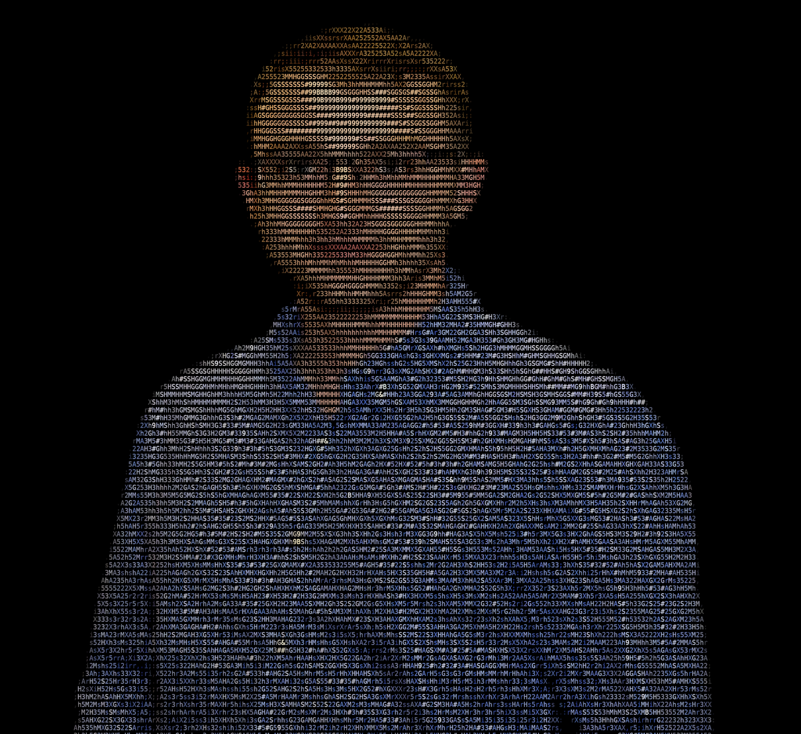

# ASCII Art Generator

A Python image and video-to-ASCII art converter that transforms images and videos into text-based artwork directly in the terminal.

Supports multiple rendering styles, high-detail Unicode Braille characters, full RGB color rendering, and export options for both images and videos.

## Features

### Three Rendering Styles

**1. Clean ASCII**
- Converts images into traditional ASCII characters.
- Uses character density to represent brightness and contrast.
- Produces recognizable artwork using standard text characters.

**2. Detailed ASCII**
- Uses an expanded character set for greater visual precision.
- Captures finer textures, shadows, and details.
- Ideal for complex images and photographs.

**3. High Detail Unicode**
- Uses Unicode Braille characters for increased visual detail.
- Represents image information using 2×4 pixel blocks.
- Supports adjustable brightness thresholds.
- Ideal for intricate images requiring greater precision.

### Original Color Support

Choose between monochrome and full-color rendering.

- **Monochrome:** Traditional text-based ASCII artwork.
- **Original Colors:** Preserves the source image's RGB colors using ANSI terminal color codes.
- **24-bit RGB:** Supports millions of colors for detailed color reproduction.

### Image and Video Conversion

Convert both static images and videos into ASCII artwork.

**Image Features**
- Converts supported image files into ASCII or Unicode artwork.
- Displays the generated artwork directly in the terminal.
- Supports adjustable output width and detail.
- Exports monochrome artwork as `.txt`.
- Exports colored artwork as `.html`.

**Video Features**
- Converts videos into ASCII artwork frame by frame.
- Supports all three rendering styles.
- Supports both monochrome and full-color output.
- Preserves the original frame rate.
- Preserves the original audio when available.
- Exports the resulting video as `.mp4`.
- Maintains the original video's pixel dimensions.

Supported video formats include:

- MP4
- MOV
- M4V
- AVI
- MKV
- WebM

### Adjustable Resolution

Control the level of detail by specifying the output width.

- Lower widths produce smaller, simpler artwork.
- Higher widths produce more detailed artwork.
- Image ASCII default: 190 characters.
- Image Unicode default: 100 characters.
- Video ASCII default: 120 characters.
- Video Unicode default: 80 characters.

### Interactive Terminal Interface

The generator provides an interactive command-line interface for:

- Selecting a rendering style.
- Enabling or disabling original colors.
- Choosing an image or video.
- Adjusting output width and detail.
- Configuring Unicode brightness thresholds.
- Saving the generated artwork.

Default settings allow for quick generation without manually configuring every option.

## Installation

### 1. Clone the Repository

```bash
git clone https://github.com/timothychamplin/ascii-art-generator.git
cd ascii-art-generator
```

### 2. Create a Virtual Environment

```bash
python3 -m venv .venv
source .venv/bin/activate
```

### 3. Install Dependencies

```bash
pip install -r requirements.txt
```

Required Python packages:

- Pillow
- NumPy
- OpenCV (for video conversion)

For video conversion, FFmpeg is also required.

Install FFmpeg on macOS using Homebrew:

```bash
brew install ffmpeg
```

## Usage

Launch the generator:

```bash
python3 ascii_converter.py
```

Follow the interactive prompts to select your preferred rendering options.

## Example

The following example converts a photograph into Clean ASCII using its original colors.

### Terminal Input

```text
==================================================
           ASCII ART GENERATOR
==================================================

Rendering Styles:
1. Clean ASCII
2. Detailed ASCII
3. High Detail Unicode

Choose style (1, 2, or 3) [default: 1]: 1
Use original colors? (y/n) [default: n]: y

Enter the path to an image or video: /Users/timothychamplin/Desktop/me.JPG
ASCII width / detail [default: 190]: 190

Generating...

==================================================
Clean ASCII
Color: ON
==================================================
```

### Output

The resulting ASCII artwork is rendered directly in the terminal using the original image's colors.



The artwork can also be exported as an HTML document, preserving its RGB colors when viewed in a web browser.

## Export Options

### Monochrome Text

When color is disabled, generated artwork can be saved as a plain-text file.

Example:

```text
ascii_output.txt
```

This format preserves the ASCII characters without terminal color codes.

### Colored HTML

When color is enabled, generated artwork can be saved as an HTML document.

Example:

```text
ascii_output.html
```

The HTML export includes:

- Original RGB character colors.
- Monospaced text rendering.
- Black background.
- Browser-based viewing.

### ASCII Video

Videos are converted frame by frame and exported as MP4 files.

Example:

```text
ascii_video.mp4
```

The resulting video retains the original video's dimensions, frame rate, and audio when available.

## How It Works

### Image Processing

1. Opens the source image using Pillow.
2. Corrects image orientation using EXIF metadata.
3. Converts the image to grayscale for brightness analysis.
4. Applies automatic contrast adjustment and sharpening.
5. Resizes the image according to the selected output width.
6. Maps pixel brightness values to ASCII or Unicode characters.
7. Optionally applies the original RGB colors.
8. Displays the resulting artwork in the terminal.

### ASCII Character Mapping

For traditional ASCII rendering, pixel brightness determines which character is selected.

Darker regions are represented using less visually dense characters, while brighter regions use denser characters.

Two character sets are available:

- Clean ASCII
- Detailed ASCII

### Unicode Braille Rendering

High Detail Unicode mode uses Unicode Braille characters.

Each character represents a 2×4 pixel grid, allowing multiple image pixels to be represented within a single text character.

A configurable brightness threshold controls which Braille dots are displayed.

### Video Processing

Video conversion uses OpenCV and FFmpeg.

1. Reads the source video frame by frame.
2. Converts each frame into ASCII or Unicode artwork.
3. Renders the characters onto an image.
4. Resizes the rendered frame to the original video dimensions.
5. Encodes the converted frames into an MP4 video.
6. Uses FFmpeg to preserve the original audio when present.

## Technologies

- **Python 3** — Core application logic.
- **Pillow (PIL)** — Image processing, resizing, contrast, and sharpening.
- **NumPy** — Array processing for video frames.
- **OpenCV** — Video frame extraction and encoding.
- **FFmpeg** — Video processing and audio preservation.
- **Unicode Braille** — High-detail text rendering.
- **ANSI True Color** — 24-bit RGB terminal output.
- **HTML/CSS** — Browser-compatible colored ASCII export.

## Project Structure

```text
ascii-art-generator/
├── ascii_converter.py
├── README.md
├── requirements.txt
└── assets/
    └── ascii_output.png
```

## Requirements

- Python 3
- A terminal supporting ANSI colors for colored terminal output
- Pillow
- NumPy
- OpenCV for video conversion
- FFmpeg for video conversion and audio preservation

## License

No license has been specified.